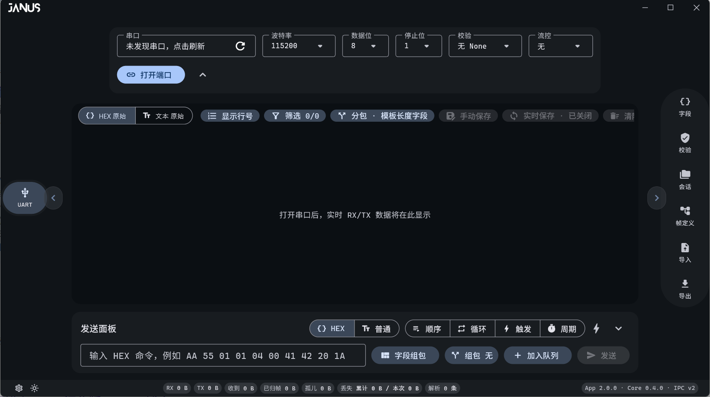
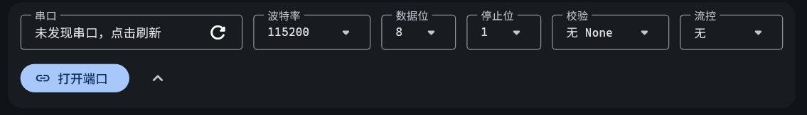

# JANUS

<p align="center">
  <picture>
    <source media="(prefers-color-scheme: dark)" srcset="Image/JANUS_LOGO_white.png">
    
  </picture>
</p>

<p align="center">
  <strong>Windows UART / COM 调试工作台</strong><br />
  实时 RX/TX · 协议帧解析 · 字段组包 · 发送队列 · 日志与会话回放
</p>

<p align="center">
  <a href="https://github.com/Tylenoler/JANUS/releases/latest">下载</a> ·
  <a href="#快速开始">快速开始</a> ·
  <a href="#核心能力">核心能力</a> ·
  <a href="#从源码构建">从源码构建</a> ·
  <a href="#常见问题">常见问题</a>
</p>

<p align="center">
  <a href="https://github.com/Tylenoler/JANUS/actions/workflows/ci.yml"></a>
  <a href="https://github.com/Tylenoler/JANUS/releases/latest"></a>
  <a href="LICENSE"></a>
  
</p>

> **JANUS · TITAN Universe** —— 双面的门神雅努斯，一面看向来路、一面看向去路；对应 RX 与 TX，也对应设备与调试者之间的边界。

JANUS 是一个原生 Windows 串口调试工作台：**Flutter** 负责界面，**Rust** 负责串口传输与性能敏感路径。它面向嵌入式 / 硬件工程师，强调**稳定收发、确定性分帧、可配置协议模板**，并且在持续流量下保持界面响应。

**English:** JANUS is a native Windows UART/COM workbench built with Flutter and Rust. It provides live RX/TX inspection, deterministic framing, user-defined protocol templates, field composition, queues and periodic sending, conditional triggers, logging, and `.janustrace` session replay. The current release is a portable Windows x64 package; the signed virtual-COM driver for monitor mode is not bundled yet.

---

## 目录

- [JANUS 是什么](#janus-是什么)
- [核心能力](#核心能力)
- [界面预览](#界面预览)
- [下载与安装](#下载与安装)
- [快速开始](#快速开始)
- [使用指南](#使用指南)
- [协议帧模板](#协议帧模板)
- [日志、筛选与会话](#日志筛选与会话)
- [旁路监听](#旁路监听)
- [项目结构](#项目结构)
- [架构与性能](#架构与性能)
- [从源码构建](#从源码构建)
- [测试与发布](#测试与发布)
- [常见问题](#常见问题)
- [系统要求与已知限制](#系统要求与已知限制)
- [参与贡献](#参与贡献)
- [许可证与致谢](#许可证与致谢)

---

## JANUS 是什么

JANUS 把日常串口调试拆成四件互相衔接的事：

1. **连接**：扫描并打开 Windows COM 口，配置波特率、数据位、停止位、校验与流控。
2. **接收**：把 UART 字节流按固定长度、帧头/帧尾或模板长度字段切成可检查的帧。
3. **解析与发送**：用可视化帧模板解析字段、校验和；再按模板组包，手动、排队、周期或条件触发发送。
4. **留痕与复现**：统一日志、筛选/导出、实时保存，以及 `.janustrace` 会话的离线回放。

它不是示波器、逻辑分析仪或高速波形工具；范围是 **UART / COM 串口通信与协议帧分析**。

---

## 核心能力

### 连接与线路控制

- 扫描 Windows COM 口，显示端口名、设备描述、USB VID/PID 与硬件 ID。
- 波特率支持常见值与自定义输入（自定义入口位于波特率下拉底部）；数据位 5–8；停止位 1/2；校验 无 / 奇 / 偶；流控 无 / RTS-CTS / XON-XOFF。
- 打开/关闭端口、连接状态实时反馈、收发字节统计。
- 已连接时切换 **DTR / RTS**，发送 **Break**（当前界面固定 250 ms）。
- 异常断开后可选择按当前参数 **自动重连**。

> 当前版本不支持 Mark / Space 校验位。

### 接收与分帧

- **HEX 原始** 与 **文本原始** 两种视图，共用同一数据源；可显示行号。
- RX 蓝 / TX 绿方向标识，时间戳可切换时区。
- 三种确定性分帧：
  - 固定长度
  - 帧头 + 帧尾
  - 模板长度字段（帧头偏移、长度偏移、宽度、大小端、长度修正）
- **同流多模板识别**：同一 UART 字节流上并行匹配模板库中的所有模板，可用固定数值字段区分共用帧头的命令/响应。
- 未匹配字节标记为 **孤儿字节**，未完成候选标记为 **未完成帧**，便于定位协议问题。
- 状态栏实时显示收到、已归帧、孤儿、丢失与解析条数；Core 背压丢弃会明确计数。

### 协议帧模板

- 字段类型：**帧头 / 长度 / 数据域 / 校验 / 帧尾 / 数值字段**。
- 字段属性：名称、字节数、大小端、固定 HEX 值、是否按值匹配。
- 校验：**SUM-8** 与 **CRC-16/MODBUS**（模板内）；完整校验模块另支持 CRC-8、CRC-16 多种变体、CRC-32、MD5/SHA 等。
- 字段拖拽排序、模板复制、模板库切换、JSON 导入/导出。
- **请求 / 响应配对**：模板可标注请求帧或响应帧，指定“响应于”，并用配对字段消除并发请求歧义；默认 2 秒超时并记录往返耗时。

### 发送与自动化

- 单条发送，HEX 或 UTF-8 文本；可追加 CR / CRLF / LF。
- **字段组包**：按模板填写字段，自动生成长度、SUM-8 / CRC-16-MODBUS 与大小端数值。
- **指令队列**：启用/禁用、上移/下移、删除确认；支持顺序发送、循环发送与手动触发一轮。
- **周期发送**：由 Rust Core 独立线程调度（10 ms–1 h），不受 UI 渲染或日志压力影响。
- **可视化条件触发**：匹配 RX（或 RX/TX）HEX，或按模板字段匹配 HEX/数值；命中后发送一条命令和/或添加书签。规则带 250 ms 防抖，不执行任意脚本。
- 队列预设可导入/导出 JSON；触发规则会自动持久化。

### 日志与会话

- 原始收发日志与结构化解析视图分离；解析视图有上限，原始字节流与导出保持完整。
- 按方向、HEX 或书签筛选；复制选中行为可读的两行记录；导出当前筛选片段。
- 手动保存 **CSV / TXT**；实时保存可关闭、CSV 或 TXT，并支持启动时续写上次文件。
- **`.janustrace` 会话**：保存原始 RX/TX、书签、帧模板、串口参数、队列与触发规则。
- 离线回放支持暂停、单步、0.25× / 1× / 4×、拖动定位与书签跳转；载入会话**不会自动打开串口**。

### 界面与体验

- Material 3，深色默认并支持一键浅色；中文字体使用按用字裁剪的 Noto Sans SC 子集。
- 左侧 UART 导航；右侧工具导轨放置字段、校验、会话、帧定义、导入、导出。
- 底部状态栏汇总设置、主题、串口摘要、实时计数与构建身份（计数与版本使用胶囊标签）；串口配置收起时，状态摘要以弹出动效出现在左下角（未连接红色、已连接绿色）。
- 关于页显示 App / Core / IPC 版本、TITAN Universe 标识、开发者、仓库地址、Git 提交与构建时间。
- 高频日志不做逐条入场动画；数据流刷新与解析结果均经过批处理与缓存。

---

## 界面预览

### 主窗口



### 连接配置



---

## 下载与安装

1. 打开 **[Releases](https://github.com/Tylenoler/JANUS/releases/latest)**。
2. 下载 `JANUS-v2.0.0-windows-x64.zip`。
3. 解压到同一目录，运行 `JANUS.exe`。

| 项目 | 大小 |
|---|---:|
| 压缩包下载 | 约 **13.5 MiB** |
| 解压后 | 约 **31.9 MiB** |

请保持以下内容在同一目录，它们共同组成完整程序：

```text
JANUS.exe
janus-core.exe
data/
flutter_windows.dll
file_selector_windows_plugin.dll
```

> 发布包未做商业代码签名，Windows SmartScreen 可能提示未知发布者。请优先从本仓库 Releases 下载，并用 `SHA256SUMS.txt` 核对文件完整性。

---

## 快速开始

1. 连接 USB 转串口设备或开发板，确认 COM 口出现在系统中。
2. 启动 `JANUS.exe`。
3. 在连接配置区选择 COM 口，设置波特率、数据位、停止位、校验与流控。
4. 点击 **打开端口**。
5. 在接收区选择 **HEX 原始** 或 **文本原始**；需要协议分析时，在接收工具栏选择分帧方式。
6. 在发送面板输入 HEX/文本，或使用 **字段组包** 生成完整帧后发送。

---

## 使用指南

### 1. 打开与关闭串口

- 端口下拉框会显示设备描述；未发现端口时可点击刷新重新扫描。
- 连接成功后，端口选择会锁定，避免误切换。
- 关闭端口使用红色 **关闭端口** 按钮；异常断开可按设置自动重连。
- 需要硬件流控时选择 **RTS/CTS**；需要软件流控时选择 **XON/XOFF**。

### 2. 选择分帧方式

接收工具栏的 **分包** 菜单提供：

| 模式 | 适用场景 |
|---|---|
| 模板长度字段 | 协议有帧头 + 长度字段；推荐用于固定模板 |
| 固定长度 | 每条记录长度固定 |
| 帧头 + 帧尾 | 协议以分隔符界定帧边界 |

使用模板长度字段时，模板需要同时包含 **帧头** 与 **长度** 字段。长度字段默认表示数据域字节数，JANUS 会自动把其他固定字段计入整帧长度。

### 3. 定义帧模板

1. 打开右侧导轨的 **帧定义**。
2. 设置模板名称、用途（普通 / 请求 / 响应）。
3. 添加或拖拽字段，填写名称、字节数、大小端、固定值。
4. 校验字段选择 **SUM-8** 或 **CRC-16/MODBUS**。
5. 在预览输入框粘贴一段 HEX，实时查看字段拆分与校验结果。
6. 保存后可在 **字段** 面板查看结构化解析；模板库支持复制、删除与 JSON 导入/导出。

### 4. 发送

- **HEX**：`AA 55 01 00`，空格可省略。
- **文本**：按 UTF-8 编码发送。
- **组包**：选择 CR / CRLF / LF 追加行尾。
- **字段组包**：按当前模板填写字段，长度与校验自动生成。
- **加入队列**：把当前输入加入队列；右侧 **顺序 / 循环 / 触发** 控制发送方式。
- **周期**：设置间隔后开始/停止，由 Core 独立线程执行。

### 5. 条件触发

在发送面板标题栏的闪电按钮中管理规则：

- 匹配 RX 或 RX/TX 的 HEX 片段；或
- 按模板字段匹配 HEX/数值；
- 命中后发送一条命令，和/或把当前记录加入书签；
- 250 ms 防抖，避免同一段流量重复触发。

### 6. 请求 / 响应配对

- 在帧模板中把模板标为 **请求帧** 或 **响应帧**。
- 响应帧指定 **响应于** 哪个请求模板。
- 可选 **配对字段**：当多个请求并发时，用字段值区分响应归属。
- 打开右侧 **会话** 可查看等待、超时与往返耗时；默认超时 2 秒。

### 7. 日志与回放

- 接收区顶部的 **筛选** 支持方向、HEX 与书签；筛选结果可单独导出。
- **手动保存** 输出 CSV/TXT；**实时保存** 可持续写入文件。
- **会话** → **保存会话** 生成 `.janustrace`；**打开会话** 进入离线回放。
- 回放不会重新打开串口，适合把现场数据交给同事复现。

---

## 协议帧模板

模板是可移植 JSON。下面是最小示例：

```json
{
  "version": 1,
  "id": "my-frame",
  "name": "示例帧",
  "role": "other",
  "fields": [
    {
      "id": "header",
      "kind": "header",
      "name": "帧头",
      "byteLength": 2,
      "valueHex": "AA 55"
    },
    {
      "id": "length",
      "kind": "length",
      "name": "长度",
      "byteLength": 1,
      "byteOrder": "bigEndian"
    },
    {
      "id": "payload",
      "kind": "payload",
      "name": "数据域"
    },
    {
      "id": "checksum",
      "kind": "checksum",
      "name": "校验",
      "byteLength": 1,
      "checksumAlgorithm": "sum8"
    },
    {
      "id": "trailer",
      "kind": "trailer",
      "name": "帧尾",
      "byteLength": 1,
      "valueHex": "0D"
    }
  ]
}
```

字段 `kind` 取值：`header`、`length`、`payload`、`checksum`、`trailer`、`integer`。  
字节序 `byteOrder`：`bigEndian` 或 `littleEndian`。  
模板校验算法：`sum8` 或 `crc16Modbus`。

---

## 日志、筛选与会话

- **原始流**：按 Core 交付的显示批次记录，HEX 源数据不丢失。
- **解析视图**：按模板拆字段，超过上限时滚动移除较早记录，但原始流仍完整保留。
- **筛选**：方向（全部/RX/TX/书签）与 HEX 子串组合过滤。
- **导出**：CSV 带表头与字节数；TXT 保留时间、方向与 HEX。
- **实时保存**：选择关闭、CSV 或 TXT；启动时可续写上次文件。
- **`.janustrace`**：保存工作台状态与原始记录；载入只恢复界面与回放数据，不接触物理串口。

---

## 旁路监听

JANUS 仓库包含自研 Windows 虚拟串口驱动 `janus-vcom`：

```text
JANUS Core ── DeviceIoControl ── \\.\JanusVcomCtl ── janus-vcom.sys
```

工作方式：

1. JANUS 打开真实物理 COM 口。
2. 通过 `janus-vcom` 创建一对虚拟端口。
3. 外部软件连接虚拟端口的一端；JANUS 在真实端口与虚拟端口之间双向转发，并统一记录 RX/TX。
4. 监听模式下 JANUS 不主动写入，避免成为第二个发送方。

> **v2.0.0 不包含已签名的驱动包。** 改名后的 `janus-vcom` 是新的驱动二进制，需要重新构建并通过 Microsoft 签名后才能分发监听模式。当前版本请使用物理 COM 口。源码与构建脚本位于 [`driver/janus-vcom/`](driver/janus-vcom/)。

---

## 项目结构

| 路径 | 用途 |
|---|---|
| `lib/` | Flutter 桌面界面、IPC 客户端、协议模型与分帧逻辑 |
| `core/` | Rust 串口传输核心，生成 `janus-core.exe` |
| `protocol/stdio-ndjson.md` | Flutter 与 Core 的 NDJSON / stdio IPC 契约 |
| `driver/janus-vcom/` | Windows 虚拟串口驱动源码与安装器 |
| `Image/` | 品牌资源（字标、方形图标） |
| `docs/images/` | README 截图 |
| `tool/` | 字体子集、图标生成、性能与压力测试工具 |
| `scripts/` | 初始化与发布脚本 |
| `test/` | Flutter 单元/组件测试 |
| `产品说明书.md` | 产品定义、功能边界与里程碑 |
| `设计规范.md` | Material 3 设计系统与交互规范 |
| `交接说明.md` | 给接手开发者的项目全貌 |

---

## 架构与性能

```text
┌─────────────────────────────┐
│ Flutter UI (lib/)           │
│ 工作台 / 模板 / 日志 / 回放  │
└──────────────┬──────────────┘
               │ stdio NDJSON (IPC v2)
┌──────────────▼──────────────┐
│ Rust Core (janus-core.exe)   │
│ 串口 I/O · 周期发送 · 转发   │
└──────────────┬──────────────┘
               │ Windows COM / janus-vcom
┌──────────────▼──────────────┐
│ USB-UART / 目标设备          │
└─────────────────────────────┘
```

关键设计：

- **串口 I/O 在 Rust 线程**：Flutter 事件循环不直接阻塞在 `ReadFile`/`WriteFile` 上。
- **确定性显示边界**：Core 在 6 ms RX 空闲或 4 KiB 时提交显示批次；这是显示边界，不是协议帧边界。
- **有界队列与显式背压**：显示事件队列最多 512 条；消费不过来时丢弃显示批次，但读线程继续工作，并上报累计/本次丢失字节数。
- **不阻塞的写路径**：转发路径不调用 `FlushFileBuffers`；周期发送使用独立线程。
- **UI 批处理**：接收更新按约 33 ms 合并，解析结果缓存；高频日志不做逐条动画。
- **解析视图有界**：解析列表达到上限后滚动移除，原始字节流、导出与统计不受影响。

IPC 细节见 [`protocol/stdio-ndjson.md`](protocol/stdio-ndjson.md)。

---

## 从源码构建

### 前置要求

- Windows 10 / 11 x64
- Flutter stable，启用 Windows desktop support
- Rust stable（Cargo）
- Visual Studio 2022，安装 “Desktop development with C++”（构建 Windows 壳）
- 可选：Windows Driver Kit / KMDF（仅构建 `janus-vcom` 驱动）

### 一键构建

```powershell
git clone https://github.com/Tylenoler/JANUS.git
cd JANUS
.\scripts\bootstrap.ps1 -Build
```

脚本默认使用 `D:\Fluttersdk\flutter` 与 `D:\Rust`。如果工具链在别处：

```powershell
.\scripts\bootstrap.ps1 -Build -FlutterSdk C:\path\to\flutter -RustRoot C:\path\to\rust
```

### 手动构建

```powershell
flutter pub get
cargo test --manifest-path core/Cargo.toml
flutter analyze
flutter test
flutter build windows --release --no-tree-shake-icons
```

产物位于 `build\windows\x64\runner\Release\`，其中应包含 `JANUS.exe` 与 `janus-core.exe`。

> 保留 `--no-tree-shake-icons`：增量图标子集化在新增 `Icons.*` 后可能复用旧子集，导致 Release 中图标空白。

### 重新生成资源

```powershell
# 新增中文界面文案后，重新裁剪中文字体
python tool/subset_janus_font.py

# 重新生成圆角 Windows 图标
python tool/make_app_icon.py
```

### 构建虚拟串口驱动

```powershell
.\driver\janus-vcom\build.ps1 -Configuration Release
```

驱动包会生成在 `driver\janus-vcom\out\x64\Release\package`。**正式分发前必须通过 Microsoft Hardware Dev Center 签名**；本地构建产物不能直接作为可发布驱动。

---

## 测试与发布

```powershell
flutter analyze
flutter test
cargo fmt --manifest-path core/Cargo.toml -- --check
cargo test --manifest-path core/Cargo.toml
```

完整发布校验：

```powershell
.\scripts\build_release.ps1
```

脚本会依次执行 Dart 格式检查、`flutter analyze`、Flutter 测试、Rust 测试、Windows Release 构建、产物新鲜度检查、启动响应检查、SHA256 生成；若提供已签名驱动包，还会校验内核签名。

CI 工作流见 [`.github/workflows/ci.yml`](.github/workflows/ci.yml)。

---

## 常见问题

### 为什么有两个可执行文件？

`JANUS.exe` 是 Flutter 界面；`janus-core.exe` 是 Rust 串口核心。JANUS 启动 Core 并通过 stdio NDJSON 通信。两者必须放在同一目录。

### `data/app.so` 和 `flutter_windows.dll` 是什么？

- `data/app.so`：Dart 代码 AOT 编译后的应用快照（Windows 上也使用 `.so` 扩展名），包含界面与业务逻辑。
- `flutter_windows.dll`：Flutter 引擎运行时，包含嵌入层、Dart 运行时、渲染器与文本排版。所有 Flutter Windows 应用都需要它。

### 需要联网吗？

不需要。串口通信、协议解析、日志与会话回放都在本地完成。

### 旧版 `.hcomtrace` 会话能打开吗？

不能。v2.0.0 起使用 `.janustrace` 与 `janus-` 前缀的格式标识，不读取 HPCom 时代的会话与队列预设。帧模板是通用 JSON，仍可导入。

### 中文界面缺字怎么办？

JANUS 内置的是 Noto Sans SC 子集，覆盖当前界面与文档用字；用户输入或设备输出中的生僻字会回退到 Windows 系统字体。新增中文界面文案后，运行 `python tool/subset_janus_font.py` 重新生成字库。

### 为什么监听模式不能直接用？

`janus-vcom` 是内核驱动，改名后的新包需要重新通过 Microsoft 签名。v2.0.0 的发布包不包含签名驱动，因此请使用物理 COM；源码与构建流程已经保留。

### 支持 Mark / Space 校验吗？

当前 Core 与界面只支持 无 / 奇 / 偶 校验。

### 下载后 Windows 提示未知发布者？

发布包没有商业代码签名，SmartScreen 可能拦截。请从本仓库 Releases 下载，并用 `SHA256SUMS.txt` 校验；不要运行来源不明的改包。

---

## 系统要求与已知限制

- Windows 10 / 11，64 位。
- 可用的物理串口设备及其 Windows 驱动。
- v2.0.0 仅随附物理 COM 工作流；签名虚拟 COM 驱动与完整监听模式待后续发布。
- 当前不包含 TCP / UDP / 蓝牙 / CAN / I2C 等扩展通信（产品路线中预留插件化扩展）。
- 不做示波器、逻辑分析仪或高速波形抓取。
- 旧版 HPCom 会话与队列预设不兼容；帧模板 JSON 兼容。

---

## 参与贡献

欢迎提交 Issue 与 Pull Request。报告串口问题时，请尽量附上：

- Windows 版本与位数
- USB 转串口芯片/适配器型号
- 目标设备与波特率、数据位、校验、停止位、流控
- 可复现步骤、期望结果与实际结果
- 相关日志或最小 `.janustrace` 片段（注意脱敏）

提交代码前请运行：

```powershell
dart format --set-exit-if-changed lib test
flutter analyze
flutter test
cargo fmt --manifest-path core/Cargo.toml -- --check
cargo test --manifest-path core/Cargo.toml
```

修改 Flutter/Core 的 IPC 前，请先同步更新 [`protocol/stdio-ndjson.md`](protocol/stdio-ndjson.md)。

---

## 许可证与致谢

本项目采用 **Apache License 2.0**，详见 [LICENSE](LICENSE)。

内置字体遵循各自许可证：

- Noto Sans SC：SIL Open Font License，见 [`assets/fonts/OFL.txt`](assets/fonts/OFL.txt)
- Cascadia Code：SIL Open Font License，见 [`assets/fonts/CascadiaCode-OFL.txt`](assets/fonts/CascadiaCode-OFL.txt)

感谢 Flutter、Rust、`serialport` 以及所有开源依赖的维护者。

---

## TITAN Universe

JANUS 是 **TITAN 宇宙** 中的双向串口工作台。名字取自罗马神话中的双面门神雅努斯：一面回望来路，一面注视去路。它对应串口的 RX 与 TX，也对应调试工作中“设备侧”与“工程师侧”的边界。

> 版本：App `2.0.0` · Core `0.4.0` · IPC `v2`
